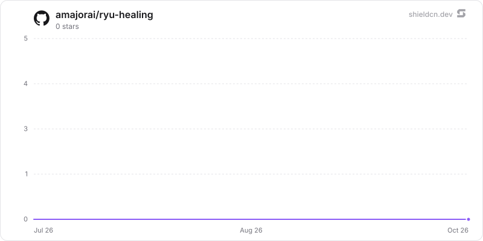

<div align="center">

# healing

</div>

Failed runs are diagnosed (Gateway side-model) and a fix is proposed to the approvals inbox.

> **The public home of `ryu-healing`.** Source, builds, and releases live here —
> binaries for every platform are attached to each release.
>
> This tree is generated from the Ryu monorepo, so commits pushed here
> directly are replaced on the next sync. **Pull requests are welcome** —
> open them here and they are ported into the monorepo, then flow back out.
> Ryu as a whole: https://github.com/amajorai/ryu

## Install

**App:** [Install](ryu://apps/com.ryu.healing) (opens the Ryu desktop app and asks you to confirm)

**CLI:**

```bash
ryu apps add com.ryu.healing
```

**From source:**

```bash
cargo build --release --manifest-path backend/Cargo.toml
```

Prebuilt binaries for every platform are attached to [each release](https://github.com/amajorai/ryu/releases).

## License

Apache-2.0 — see [LICENSE](./LICENSE).

## What it adds

- The `ryu-healing` local sidecar, mounted at `/api/healing`.
- The `@ryu/healing#diagnosis.ready` hook event, which fires once per heal
  attempt before the fix is acted on, whether the run is retried automatically
  (`auto_apply`) or the fix goes to the approvals inbox.

It requires the Approvals app (`@ryu/approvals`), where proposed fixes are
reviewed.

## Star History

<a href="https://github.com/amajorai/ryu-healing/stargazers">
  <picture>
    <source media="(prefers-color-scheme: dark)" srcset="./.github/shieldcn/star-chart-dark.svg" />
    
  </picture>
</a>
